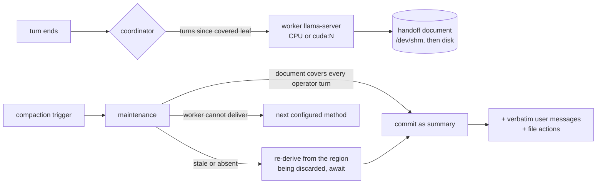

# RabidAI

A fork of [oh-my-pi](https://github.com/can1357/oh-my-pi) whose purpose is one mechanism:
**compacting a long session without making the inference model re-read a saturated context.**

A small model, running on the CPU or on a second GPU, maintains a rolling handoff document
for the live session — one stateless run per completed turn. When compaction triggers, the
harness commits that document instead of paying the main model for a summary of a context
that no longer fits. The parts that must never drift are written by the harness, not by the
model: the user's own messages verbatim, and the turn's file actions extracted from tool
calls.

`rig/` carries the local serving stack this was built against: a V100 router, a manager web
page, and the SLM worker panel. Clone, install, drop in weights, run.

## Why

On a one-GPU box, compaction is the most expensive thing a session can do: the only card
must prefill the entire window before the next turn can run. On a 163 840-token window that
is minutes of downtime, repeated as the session grows.

A 3–4B model on the idle CPU (or the gaming card) can do that work off the critical path,
but it paraphrases and drops things — measured: a 0.5B dropped a `MUST use port 8451`
requirement outright; a 3B invented a command it never ran. So the design splits the job:

| Content | Author | Why |
|---|---|---|
| Requirement lines, operator asks | **harness** — verbatim, cumulative | a summarizer cannot lose what it never wrote |
| File paths, commands | **harness** — extracted from tool calls | a path in the summary is a path the session touched |
| Goal, progress, decisions, context, next steps | **worker model** | judgment is what the model is for |
| "Learned / Implemented" prose | **worker model**, grounded in the action log | constrained to paths it was given |

Every text compaction carries both harness blocks — `slm`, `handoff`, `soft`, and
provider-native `remote` — so the fidelity guarantee does not depend on running a worker at
all.

## How it works



- **Stateless runs.** Each request is `system + previous document + new turns`. The model
  never sees its own earlier answers, so there is no self-reinforcing thought loop; the
  document is the only state.
- **Coverage is about asks.** A document is usable when every *operator* turn is covered;
  trailing assistant output and the compaction summary itself need no new run. Coverage is
  keyed by message identity, so a foreign or stale document can never claim it.
- **Waiting happens once.** Per-turn runs are fire-and-forget and never delay prompt
  admission. Compaction waits up to `awaitMs` for a stale document before falling back to
  the next method — and when it waits, it re-derives from the region it is about to discard
  rather than trusting a chain that may have drifted.
- **Isolation.** Files are keyed by the transcript id plus a SHA-256 digest (a fork, an
  SDK-supplied provider id, or punctuation-only id differences cannot share or collide);
  the RAM copy is namespaced per agent dir; a copy whose metadata names another session is
  refused on read rather than merged.

## Measured on the reference rig

V100 32 GB for inference, RTX 3070 8 GB for display, 16-thread i9. Main model
Qwen3.8-27B MTP Q4_K_M.

| | value |
|---|---|
| Main model decode | 36 tok/s |
| Harness baseline context | 1 948 tokens (24 % of an 8 K window) |
| Worker, SmolLM3-3B Q4_K_M, 8 K ctx | 9.8 tok/s, 23 s per turn |
| Worker, Spark-X2.5-4B Q4_0, budget 0 | 25.6 s per turn; 118 s at a 1024 thinking budget |
| Worker, Qwen2.5-0.5B (fastest, weakest) | 40 tok/s; drops requirements on long input |
| Worker RAM at 262 144 ctx / at 16 K | 12.5 GB / 2.8 GB |
| Worker on the 3070, `gpuFreeMiB: 2048` | +1.18 GB VRAM, ~2 GB left free |

A commit reads `method: "slm"` with no main-model summarization request; the handoff file
was written 3 ms before the commit that consumed it.

## Configure

```yaml
# ~/.omp/profiles/rabid/agent/config.yml
compaction:
  methodOrder: [slm, shake, handoff, soft]   # slm first, real fallbacks behind it
  speedFloorTps: 20                          # also compact when decode decays below this
  slmHandoff:
    modelPath: ~/models/Spark-X2.5-4B-Q4_0.gguf
    device: cuda:1            # cpu | cuda | cuda:N   (never the inference card by default)
    gpuFreeMiB: 2048          # leave this much VRAM free; -1 offloads everything
    maxContextTokens: 16384   # one run only reads the delta, not the whole window
    reasoningBudgetTokens: 0  # 1024 for richer merges, ~4x the wall time
    detail: detailed          # concise | standard | detailed prose register
    awaitMs: 300000
```

`/models-worker` downloads the default GGUF, loads and holds a worker, puts `slm` first in
`compaction.methodOrder` (appending `handoff` if that would leave no fallback), reports
budgets, and unloads. The harness also spawns a worker on demand — the command is for
preloading and inspection, not a prerequisite.

## Quick start

```sh
git clone https://github.com/jaruizramon/RabidAI.git && cd RabidAI
./rig/install.sh --dry-run      # then without the flag
# llama.cpp stock + PrismML fork under ~/.local/opt, `bun`, `python3`, `hf`
hf download …                   # the lines install.sh printed for missing weights
llama-manager start             # http://localhost:8090
omp --profile rabid
```

## The rig

`rig/` — manager page, router presets, proxy, tool filter, wrappers, installer, and the
model checklist — is documented in [`rig/README.md`](rig/README.md).

| Port | Owner |
|---|---|
| 8080 | router (`llama-server --models-preset`), one resident model |
| 8090 | manager UI + `/api/*` (starts and stops the router) |
| 8101 | tool filter (strips named tools from requests) |
| ephemeral | SLM worker, chosen per load |

The manager page carries model cards with measured VRAM, context parking, logs, an **SLM
handoff worker** panel (load/stop on `cuda:N` or CPU, ctx, VRAM headroom, live worker
CPU %/RSS) and a **load** panel (system CPU busy + load average, per-GPU utilisation and
memory).

## Layout

```
packages/coding-agent/src/session/slm-handoff.ts   coordinator, handoff format, isolation
packages/coding-agent/src/session/slm-server.ts    supervised worker + chat client
packages/coding-agent/src/prompts/system/slm-handoff*.md   worker prompts (three registers)
packages/coding-agent/src/slash-commands/builtin-worker-model.ts   /models-worker
rig/                                               serving stack + installer
SLM-HANDOFF-TESTS.md                               lab notebook: every run, measurement, defect
docs/compaction.md                                 the method in context of the other methods
```

## Upstream

RabidAI is a fork; the harness, tools, providers and docs above `rig/` are oh-my-pi's work.
The upstream README is kept at [`docs/upstream-readme.md`](docs/upstream-readme.md);
upstream project and releases live at [can1357/oh-my-pi](https://github.com/can1357/oh-my-pi)
([omp.sh](https://omp.sh)). Sync with `git fetch upstream && git merge upstream/main` —
`rig/` and the `slm-*` modules are the fork's own surface.

## Status and limits

- Requirement and file-action fidelity is a **harness guarantee**; the rest of the document
  is only as good as the worker. A 3B can miss the newest turn's subject, and the block is
  what keeps the successor usable anyway.
- `omp -p` one-shots abort an in-flight per-turn handoff at exit (~5 s grace) — the TUI and
  long-running sessions get the chain; the compaction path always awaits.
- The manager's worker and the session's worker are independent processes; run one or the
  other on a given GPU budget.
- Handoff prose is capped by `maxHandoffTokens` (2 048 by default) and the detail register;
  verbose output costs successor context.
