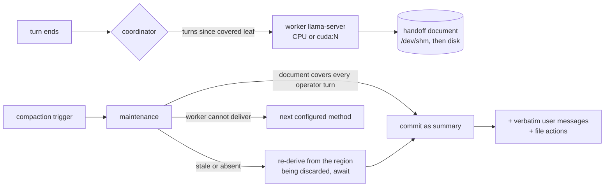

# RabidAI

My setup, kept in one repository: a duplicator for this box, the background compaction
handoff it runs, and the harness those two live in. Three things, because they only work
together — a single inference GPU, a gaming card, and local models.

> The harness is built on [oh-my-pi](https://github.com/can1357/oh-my-pi) (MIT) and that debt
> is the largest one here. Attribution, what is upstream and what is mine:
> [`CREDITS.md`](CREDITS.md). Everything not listed in [`rabid/docs/FORK.md`](rabid/docs/FORK.md)
> is upstream work, unmodified.

| Pillar | What it is | Where |
|---|---|---|
| **1. The compaction mechanism** | A small model on the CPU (or the gaming card) keeps a rolling handoff document current, one stateless run per turn. Compaction commits that document instead of making the inference model re-read a saturated context. The parts that must never drift are written by the harness, not the model. | [`packages/coding-agent/src/slm/`](packages/coding-agent/src/slm), [`docs/compaction.md`](docs/compaction.md) |
| **2. The harness that supports it** | A heavily modified fork of [oh-my-pi](https://github.com/can1357/oh-my-pi): maintenance, compaction, the token meter, the TUI, the provider layer and the catalog all diverge, not just a config profile. | [`packages/coding-agent/src/rabid/`](packages/coding-agent/src/rabid), [`rabid/docs/FORK.md`](rabid/docs/FORK.md) |
| **3. The setup duplicator** | The serving stack for a new rig: manager web page, llama.cpp routers and presets, tool filter, wrappers, an idempotent installer, and the exact `hf download` line for every weight. | [`rabid/rig/`](rabid/rig), [`rabid/rig/README.md`](rabid/rig/README.md) |

Clone it on a new machine, run [`rabid/rig/install.sh`](rabid/rig/install.sh), install the
weights it lists by name, and the harness plus the rig come up the same way they do here.
The mechanism ships inside the harness, so the two are never out of step; the rig is what
the harness talks to.

## Why

On a one-GPU box, compaction is the most expensive thing a session can do: the only card
must prefill the entire window before the next turn can run. On a 163 840-token window that
is minutes of downtime, repeated as the session grows.

A 3–4B model on the idle CPU (or the gaming card) can do that work off the critical path,
but it paraphrases and drops things — measured: a 0.5B dropped a `MUST use port 8451`
requirement outright; a 3B invented a command it never ran. So the design splits the job:

| Content | Author | Why |
|---|---|---|
| Requirement lines, operator asks | **harness** — verbatim, cumulative | a summarizer cannot lose what it never wrote |
| File paths, commands | **harness** — extracted from tool calls | a path in the summary is a path the session touched |
| Goal, progress, decisions, context, next steps | **worker model** | judgment is what the model is for |
| "Learned / Implemented" prose | **worker model**, grounded in the action log | constrained to paths it was given |

Every text compaction carries both harness blocks — `slm`, `handoff`, `soft`, and
provider-native `remote` — so the fidelity guarantee does not depend on running a worker at
all.

## How it works



- **Stateless runs.** Each request is `system + previous document + new turns`. The model
  never sees its own earlier answers, so there is no self-reinforcing thought loop; the
  document is the only state.
- **Coverage is about asks.** A document is usable when every *operator* turn is covered;
  trailing assistant output and the compaction summary itself need no new run. Coverage is
  keyed by message identity, so a foreign or stale document can never claim it.
- **Waiting happens once.** Per-turn runs are fire-and-forget and never delay prompt
  admission. Compaction waits up to `awaitMs` for a stale document before falling back to
  the next method — and when it waits, it re-derives from the region it is about to discard
  rather than trusting a chain that may have drifted.
- **Isolation.** Files are keyed by the transcript id plus a SHA-256 digest (a fork, an
  SDK-supplied provider id, or punctuation-only id differences cannot share or collide);
  the RAM copy is namespaced per agent dir; a copy whose metadata names another session is
  refused on read rather than merged.

## Test results

Every row below is a real run on the reference rig (V100 32 GB inference, RTX 3070 8 GB
display, 16-thread i9-9900K), read from the session JSONL and the handoff metadata. The
full notebook — setup, commands, defects found — is [`rabid/docs/slm-handoff-tests.md`](rabid/docs/slm-handoff-tests.md).

### A. End-to-end compaction commits

Real `SessionMaintenance` pass on a real session: main model Qwen3.8-27B at an **8192-token
window** (baseline harness context 1 948 tokens), `thresholdTokens: 2300`,
`keepRecentTokens: 200`, `methodOrder: [slm]`. "Commit" is the context size recorded on the
committed compaction entry.

| Worker | Device | VRAM headroom | Worker ctx | Thinking | Detail | Summary | Commit | Wall | tok/s |
|---|---|---|---|---|---|---|---|---|---|
| **none** (`soft`) | — | — | — | — | — | 1 084 chars | 2 422 → 2 536 | — | — |
| Qwen2.5-0.5B Q4_K_M | CPU, 4 thr | — | 8 192 | 0 | standard | 820 chars | 3 147 → 3 321 | 3.4 s | **40.4** |
| SmolLM3-3B Q4_K_M | CPU, 4 thr | — | 8 192 | 4 096 | standard | — | — | 38.1 s | 10.2 |
| SmolLM3-3B Q4_K_M | CPU, 4 thr | — | **16 384** | 1 024 | standard | 2 022 chars | 4 099 → 4 399 | 23.4 s | 9.8 |
| Spark-X2.5-4B Q4_0 | **RTX 3070** | 2 048 | 8 192 | 0 | standard | ~1 523 chars | 4 317 → 4 632 | 25.6 s | 11.6 |
| Spark-X2.5-4B Q4_0 | **RTX 3070** | 2 048 | 8 192 | 0 | **detailed** | 2 115 chars | — | 50.9 s | 10.7 |

`—` marks a field the notebook did not record for that run (the run happened; the number
was simply not captured), never a zero. Rows are rounded as measured.

**Read the Spark rows with the headroom column.** `gpuFreeMiB: 2048` is a *cap*, not a
property of the card: with the desktop already holding 4.6 GB of the 3070's 8 GB, that cap
allowed llama.cpp only ~1.2 GB of VRAM, so most layers ran on the CPU (GPU utilisation 2–6 %,
worker CPU ~400 %) — hence 11.6 tok/s. Lowering the cap to 512 fits the whole model
(+2.67 GB, 7 324 MiB total) and the same worker measures **63.2 tok/s** (50 % GPU
utilisation), 5.4× the capped figure. Choose the cap by what else needs the card: 512–1024
for throughput, 2048+ when a game is running.

The `soft` row is the control: no worker exists, the summary is the main model's, and it
still carries the harness blocks. Every `slm` row records `method: "slm"` with **no**
main-model summarization request; in the Spark run the handoff file was written 3 ms before
the commit that consumed it.

### B. Worker throughput and behavior

Same prompts, bare worker runs (not commits), so the timings are comparable:

| Worker | Device | Ctx | Thinking | In | Out | Wall | tok/s | Outcome |
|---|---|---|---|---|---|---|---|---|
| Qwen2.5-0.5B | CPU | 8 192 | 0 | 802 | 139 | 3.44 s | **40.4** | clean headings, both requirements; repeat loop + `truncated` on a 2 500-word turn |
| Qwen2.5-0.5B | CPU | 8 192 | 0 | 590 | 139 | 3.25 s | 42.8 | second pass, chained document |
| SmolLM3-3B | CPU | 8 192 | 4 096 | 777 | 388 | 38.13 s | 10.2 | requirements kept; invented `## New information`, duplicate headings |
| SmolLM3-3B | CPU | 16 384 | 1 024 | — | 407 | 42.6 s | 9.6 | lowering the budget from 4096 bought **no** speed |
| Spark-X2.5-4B | RTX 3070, `gpuFreeMiB 2048` | 8 192 | 0 | — | 298 | 25.6 s | 11.6 | mostly CPU; requirements verbatim |
| Spark-X2.5-4B | RTX 3070, `gpuFreeMiB 512` | 8 192 | 0 | — | 292 | 4.6 s | **63.2** | whole model on the card (steady state) |
| Spark-X2.5-4B | RTX 3070, `gpuFreeMiB 512` | 8 192 | 0 | — | 323 | 5.1 s | 63.7 | first request after load (cold) |
| Spark-X2.5-4B | RTX 3070 | 8 192 | 1 024 | — | 1 373 | 118 s | 11.6 | thinking dominates the run |
| Spark-X2.5-4B | RTX 3070 | 8 192 | 0 | — | 546 | 50.9 s | 10.7 | `detailed` register: 2 115-char document |

Main model, same rig, for scale: **36 tok/s** decode.

### C. Cost on the box

| Setup | Memory | Note |
|---|---|---|
| SmolLM3-3B, CPU, `--ctx-size 262144` | **12.5 GB** RSS | why the window is not copied wholesale |
| SmolLM3-3B, CPU, `--ctx-size 16384` | **2.79 GB** RSS | the shipped default |
| Spark-X2.5-4B, RTX 3070, `gpuFreeMiB 2048` | **+1.18 GB** VRAM (4 637 → 5 814 MiB) | ~2 GB left free; most layers spill to CPU (11.6 tok/s) |
| Spark-X2.5-4B, RTX 3070, `gpuFreeMiB 512` | **+2.67 GB** VRAM (4 652 → 7 324 MiB) | whole model resident, 63.2 tok/s |
| Inference card during a worker run | 10 MiB idle / 23.9 GB with the 27B | untouched by the worker |

Worker CPU under generation: **~400 %** (4 threads of 16), measured through the manager
panel.

### What was not measured

Spark on CPU, SmolLM3 or Qwen2.5 on a GPU, more than two turns per session, and two
concurrent sessions sharing one worker. The matrices above are the runs the notebook
records; missing cells are unmeasured, not zero.

## Configure

```yaml
# ~/.omp/profiles/rabid/agent/config.yml
compaction:
  methodOrder: [slm, shake, handoff, soft]   # slm first, real fallbacks behind it
  speedFloorTps: 20                          # also compact when decode decays below this
  slmHandoff:
    modelPath: ~/models/Spark-X2.5-4B-Q4_0.gguf
    device: cuda:1            # cpu | cuda | cuda:N   (never the inference card by default)
    gpuFreeMiB: 2048          # leave this much VRAM free; -1 offloads everything
    maxContextTokens: 16384   # one run only reads the delta, not the whole window
    reasoningBudgetTokens: 0  # 1024 for richer merges, ~4x the wall time
    detail: detailed          # concise | standard | detailed prose register
    awaitMs: 300000
```

`/models-worker` downloads the default GGUF, loads and holds a worker, puts `slm` first in
`compaction.methodOrder` (appending `handoff` if that would leave no fallback), reports
budgets, and unloads. The harness also spawns a worker on demand — the command is for
preloading and inspection, not a prerequisite.

## Quick start

```sh
git clone https://github.com/jaruizramon/RabidAI.git && cd RabidAI
./rig/install.sh --dry-run      # then without the flag
# llama.cpp stock + PrismML fork under ~/.local/opt, `bun`, `python3`, `hf`
hf download …                   # the lines install.sh printed for missing weights
llama-manager start             # http://localhost:8090
omp --profile rabid
```

## The rig

`rig/` — manager page, router presets, proxy, tool filter, wrappers, installer, and the
model checklist — is documented in [`rabid/rig/README.md`](rabid/rig/README.md).

| Port | Owner |
|---|---|
| 8080 | router (`llama-server --models-preset`), one resident model |
| 8090 | manager UI + `/api/*` (starts and stops the router) |
| 8101 | tool filter (strips named tools from requests) |
| ephemeral | SLM worker, chosen per load |

The manager page carries model cards with measured VRAM, context parking, logs, an **SLM
handoff worker** panel (load/stop on `cuda:N` or CPU, ctx, VRAM headroom, live worker
CPU %/RSS) and a **load** panel (system CPU busy + load average, per-GPU utilisation and
memory).

## Layout

```
packages/coding-agent/
  src/slm/                 handoff.ts (coordinator, format, isolation), server.ts (supervised
                           worker), worker-command.ts (/models-worker)
  src/rabid/               the rest of the fork: turn cards, compaction rummage, speed floor,
                           rabid modes, model profiles, llama presets, TUI panels
  src/prompts/system/      slm-handoff*.md (three prose registers), turn-card.md
  test/slm/, test/rabid/   tests for both components

rabid/
  rig/                     serving stack — see rabid/rig/README.md
    manager/ router/ gateway/ bin/ omp-profile/ install.sh models.list
  docs/                    RABIDAI.md (charter), NEXT-CHAT.md, PLAN-*.md,
                           FORK.md (harness-divergence inventory), slm-handoff-tests.md

docs/                      upstream documentation (compaction.md, settings.md, …)
```

## Credits and upstream

RabidAI's harness is a modified copy of [oh-my-pi](https://github.com/can1357/oh-my-pi), MIT,
Copyright (c) 2025 Mario Zechner, (c) 2025–2026 Can Bölük, (c) 2026 Stencil Labs, Inc. —
itself a fork of [Pi](https://github.com/badlogic/pi-mono) by @mariozechner. The license text
in [`LICENSE`](LICENSE) is unchanged, the upstream README is preserved at
[`docs/upstream-readme.md`](docs/upstream-readme.md), and the full attribution — including
third-party tools and the model weights this repo does *not* ship — is in
[`CREDITS.md`](CREDITS.md).

The harness keeps upstream paths on purpose: `git fetch upstream && git merge upstream/main`
stays reviewable, and [`rabid/docs/FORK.md`](rabid/docs/FORK.md) is the inventory of what a
merge has to reconcile. `rig/`, `src/slm/`, `src/rabid/` and the harness changes listed there
are mine.

## Status and limits

- Requirement and file-action fidelity is a **harness guarantee**; the rest of the document
  is only as good as the worker. A 3B can miss the newest turn's subject, and the block is
  what keeps the successor usable anyway.
- `omp -p` one-shots abort an in-flight per-turn handoff at exit (~5 s grace) — the TUI and
  long-running sessions get the chain; the compaction path always awaits.
- The manager's worker and the session's worker are independent processes; run one or the
  other on a given GPU budget.
- Handoff prose is capped by `maxHandoffTokens` (2 048 by default) and the detail register;
  verbose output costs successor context.
